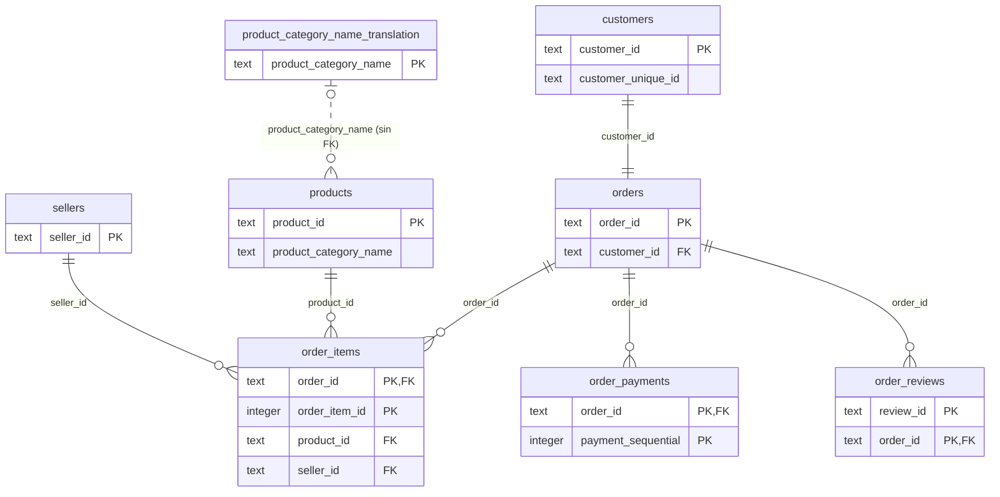

# Análisis de negocio Olist E-commerce

El objetivo de este ejercicio es realizar un análisis del negocio brasileño **Olist** mediante lenguaje SQL.

## Datos

Los datos se extraen de la web pública **Kaggle** ([Brazilian E-Commerce Public Dataset by Olist](https://www.kaggle.com/datasets/olistbr/brazilian-ecommerce)) en formato CSV y se cargan en una base de datos PostgreSQL alojada en la plataforma online **Supabase**. Se utilizan 8 tablas (sin la de geolocalización).

## Metodología

Cada consulta planteada parte de una pregunta de negocio, y se almacena en este repositorio para poder reproducirla.

## Etapas

### Etapa 1: comprensión y calidad del dato

Antes de responder preguntas de negocio, se comprueba qué datos hay y hasta dónde se puede fiarse de ellos.

- Se identifica qué registra cada tabla, su grano (qué representa una fila) y su clave.
- Se crean las claves primarias y foráneas para relacionar las tablas ([`schema/02_add_keys.sql`](schema/02_add_keys.sql)).
- Se cuentan las filas y se comprueba la unicidad de las claves.
- Se revisan el rango de fechas, los nulos y las incoherencias entre estado y fechas.
- Se concluye qué preguntas se pueden responder.

Consultas: [`queries/01_calidad_datos.sql`](queries/01_calidad_datos.sql). Resultados: [`docs/ficha_datos.md`](docs/ficha_datos.md).

### Etapa 2: de la pregunta de negocio a la consulta

La pregunta planteada es: ¿qué categorías y vendedores generan más ingresos a lo largo del período?

- Las decisiones tomadas para el planteamiento de consultas están en [`docs/decisiones.md`](docs/decisiones.md).
- El período analizado para las categorías es de Q1 2017 a Q2 2018. A mayores, debido a un corte de datos en septiembre de 2018, se realiza una comparación individual de julio y agosto 2017 con 2018.
- En cuanto a vendedores, se analiza la concentración de ventas y el número de vendedores que se necesitan para llegar al 20 % del ingreso entre Q2 2017 y Q2 2018.

Consultas: [`queries/02_ingresos_categorias_vendedores.sql`](queries/02_ingresos_categorias_vendedores.sql).

Los hallazgos encontrados son:

- A nivel categoría, se aplica un filtro para mostrar solo aquellas que superan los 5.000 de ingreso en Q2 2018. Como resultado, de las 47 categorías que se quedan, 10 de ellas reducen su ingreso con respecto al trimestre anterior.
- A nivel vendedores, en Q2 2017 hicieron falta 11 vendedores (de 779) para llegar al umbral del 20 % del ingreso y en Q2 2018, 15 vendedores (de 1.676). En bruto el ingreso está más distribuido, pero en proporción se encuentra más concentrado.

### Etapa 3: evolución y comparaciones

La pregunta planteada es ¿cómo crece la plataforma?

- Analizando el crecimiento de los ingresos mes a mes, se observa una gran variabilidad mensual de crecimiento, principalmente en los primeros meses al partir de una base pequeña. Esto lleva a calcular una media móvil a 3 meses para reducir esa variabilidad. El resultado es que la plataforma en la fase inicial tiene un gran crecimiento, de dos dígitos y se va desacelerando este crecimiento, hasta llegar a un dígito. Aunque el crecimiento es más lento, sigue siendo positivo.

- En cuanto a la evolución de las categorías en tendencia, se comparan el segundo trimestre de 2017 (abril - junio) con el de 2018, lo que muestra que dentro del top 10 todo se mantiene igual salvo 2 categorías nuevas que entran al top. Aunque el top mantiene prcticamente las mismas categorías, estas si cambiaron de posición. Las 2 categorías que pierden posición dentro del top 10, siguen generando mayores ingresos en el 2018 que 2017. 

Hay que ser cauteloso con esta información: es un análisis descriptivo que muestra qué ocurrió, pero no permite determinar por qué ocurrió ni qué va a ocurrir. Al tener un histórico de solo 19 meses, con un único ciclo anual, no se puede separar la tendencia de la estacionalidad y proyectar el futuro no es aconsejable.

Consultas: [`queries/03_crecimiento_plataforma.sql`](queries/03_crecimiento_plataforma.sql).

### Etapa 4: clientes que vuelven

La pregunta que se plantea es ¿cuántos clientes vuelven en los 3 meses siguientes?

- Analizando un rango temporal de 6 meses, un grupo actúa como base y otro como comparativa, se obtiene que de la base marzo - mayo 2018, sólo el 0.78% de clientes vuelven en el período de junio - agosto, 157 de 20.254. 
- Con un porcentaje tan bajo de clientes que vuelven, el negocio muestra una gran dependencia de nuevos clientes. Hay que ser cautelosos con esta afirmación, ya que el período analizado también resulta ser demasiado pequeño.

Consultas: [`queries/04_clientes_cohortes.sql`](queries/04_clientes_cohortes.sql).

### Etapa 5: entrega de paquetes

La pregunta que se plantea en esta última fase es, ¿los pedidos se entregan a tiempo o se retrasan respecto a la fecha estimada?

- Realizando el análisis de febrero 2017 a agosto 2018, el porcentaje de retraso general en la entrega es del 6.82%, es decir, de 95.453 pedidos registrados, 6509 llegan con retraso. Para calcular este valor se calcula la diferencia entre la fecha de entrega y la fecha de entrega estimada en el momento de la compra. Se calcula la mediana de días y nos devuelve un valor negativo, en donde los paquetes llegan con 12 días de antelación.
- Para profundizar en la información se realiza el mismo análisis mes a mes, en donde todos los meses cuentan con un porcentaje de retraso que oscila cerca del valor general de 6.82% salvo 3 excepciones: noviembre 2017 (12,4 %), febrero 2018 (14,1 %) y marzo 2018 (19,0 %).

Hay que ser cautelosos si queremos decir que la empresa cuenta con un buen servicio de mensajería, ya que la fecha estimada de entrega puede ser muy conservadora, jugando a favor de la fecha de entrega real.

Consultas: [`queries/05_tiempo_entrega.sql`](queries/05_tiempo_entrega.sql).


## Estructura del proyecto

```text
sql-olist/
├── README.md
├── docs/
│   ├── ficha_datos.md           # grano, clave y relaciones de cada tabla
│   └── decisiones.md            # decisiones metodológicas y su motivo
├── queries/
│   ├── 01_calidad_datos.sql                   # Etapa 1: filas, claves, fechas y nulos
│   ├── 02_ingresos_categorias_vendedores.sql  # Etapa 2: categorías y vendedores
│   ├── 03_crecimiento_plataforma.sql          # Etapa 3: evolución mensual, media móvil y ranking
│   ├── 04_clientes_cohortes.sql               # Etapa 4: clientes que vuelven
│   └── 05_tiempo_entrega.sql                  # Etapa 5: retraso frente a la fecha estimada
└── schema/
    ├── 01_create_tables.sql     # crea las 8 tablas
    └── 02_add_keys.sql          # añade claves primarias y foráneas (tras cargar los CSV)
```

## Esquema de relaciones



### Leyenda

**Claves**

| Símbolo | Significado |
|---|---|
| `PK` | Clave primaria: identifica cada fila de la tabla. Si aparece en varias columnas de una misma tabla, la clave es **compuesta** (hay que combinarlas). |
| `FK` | Clave foránea: la columna apunta a la clave primaria de otra tabla. |
| `PK, FK` | La columna forma parte de la clave primaria y, además, apunta a otra tabla. |

**Relaciones** (se leen en los dos sentidos: cada extremo indica cuántas filas de *ese* lado pueden estar ligadas a una fila del otro)

| Símbolo | Significado |
|---|---|
| `\|\|` | Exactamente una |
| `\|o` | Cero o una |
| `o{` | Cero o muchas |
| `--` (línea continua) | Relación con clave foránea creada en la base de datos |
| `..` (línea de puntos) | Relación lógica, sin clave foránea |

Ejemplo: `orders ||--o{ order_items` se lee "un pedido tiene cero o muchas líneas, y cada línea pertenece a exactamente un pedido".

### Notas para leer el esquema

- `customer_id` se genera **por pedido**: la persona real es `customer_unique_id`.
- `order_items`, `order_payments` y `order_reviews` tienen **clave compuesta**: un pedido puede tener varias líneas, varios pagos y varias reseñas.
- La relación entre `products` y `product_category_name_translation` es lógica y **no tiene clave foránea**: hay productos con una categoría sin traducción.

El detalle de cada tabla está en [`docs/ficha_datos.md`](docs/ficha_datos.md).
