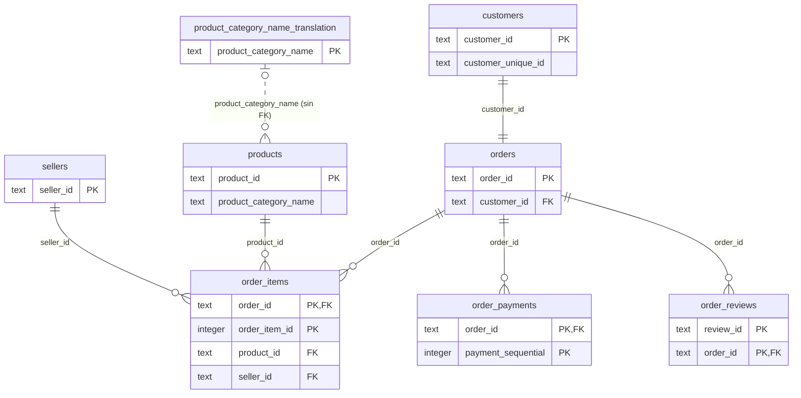

# Análisis de negocio Olist E-commerce

El objetivo de este ejercicio es realizar un análisis del negocio brasileño **Olist** mediante lenguaje SQL.

## Datos

Los datos se extraen de la web pública **Kaggle** ([Brazilian E-Commerce Public Dataset by Olist](https://www.kaggle.com/datasets/olistbr/brazilian-ecommerce)) en formato CSV y se cargan en una base de datos PostgreSQL alojada en la plataforma online **Supabase**. Se utilizan 8 tablas (sin la de geolocalización).

## Metodología

Cada consulta planteada parte de una pregunta de negocio, y se almacena en este repositorio para poder reproducirla.

## Etapas

### Etapa 1: Comprensión y calidad del dato

Antes de responder preguntas de negocio, se comprueba qué datos hay y hasta dónde se puede fiarse de ellos.

- Se identifica qué registra cada tabla, su grano (qué representa una fila) y su clave.
- Se crean las claves primarias y foráneas para relacionar las tablas ([`schema/02_add_keys.sql`](schema/02_add_keys.sql)).
- Se cuentan las filas y se comprueba la unicidad de las claves.
- Se revisan el rango de fechas, los nulos y las incoherencias entre estado y fechas.
- Se concluye qué preguntas se pueden responder, cuáles con cautela y cuáles no.

Consultas: [`queries/01_calidad_datos.sql`](queries/01_calidad_datos.sql). Resultados: [`docs/ficha_datos.md`](docs/ficha_datos.md).

## Estructura del proyecto

```text
sql-olist/
├── README.md
├── docs/
│   └── ficha_datos.md           # grano, clave y relaciones de cada tabla
├── queries/
│   └── 01_calidad_datos.sql     # Etapa 1: filas, claves, fechas y nulos
└── schema/
    ├── 01_create_tables.sql     # crea las 8 tablas
    └── 02_add_keys.sql          # añade claves primarias y foráneas (tras cargar los CSV)
```

## Esquema de relaciones



### Leyenda

**Claves**

| Símbolo | Significado |
|---|---|
| `PK` | Clave primaria: identifica cada fila de la tabla. Si aparece en varias columnas de una misma tabla, la clave es **compuesta** (hay que combinarlas). |
| `FK` | Clave foránea: la columna apunta a la clave primaria de otra tabla. |
| `PK, FK` | La columna forma parte de la clave primaria y, además, apunta a otra tabla. |

**Relaciones** (se leen en los dos sentidos: cada extremo indica cuántas filas de *ese* lado pueden estar ligadas a una fila del otro)

| Símbolo | Significado |
|---|---|
| `\|\|` | Exactamente una |
| `\|o` | Cero o una |
| `o{` | Cero o muchas |
| `--` (línea continua) | Relación con clave foránea creada en la base de datos |
| `..` (línea de puntos) | Relación lógica, sin clave foránea |

Ejemplo: `orders ||--o{ order_items` se lee "un pedido tiene cero o muchas líneas, y cada línea pertenece a exactamente un pedido".

### Notas para leer el esquema

- `customer_id` se genera **por pedido**: la persona real es `customer_unique_id`.
- `order_items`, `order_payments` y `order_reviews` tienen **clave compuesta**: un pedido puede tener varias líneas, varios pagos y varias reseñas.
- La relación entre `products` y `product_category_name_translation` es lógica y **no tiene clave foránea**: hay productos con una categoría sin traducción.

El detalle de cada tabla está en [`docs/ficha_datos.md`](docs/ficha_datos.md).
